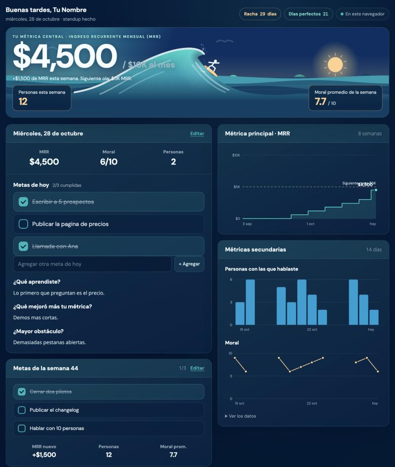

# Lineup Dashboard

*Tu standup diario con MRR, moral, metas y mini CRM. Open source.*

**Tu standup diario en una sola página: una métrica, una ola, tus metas y un mini CRM. Con tu propia tarjeta de presentación pública.**

> ¿Solo quieres la tarjeta de presentación, con QR, contacto para guardar y un asistente de IA? Está en su propio proyecto: [Digital Business Card](https://github.com/Morenazzo/digital-business-card).

Lineup es un panel personal para quien construye algo solo (o casi). Cada mañana respondes un standup corto: con cuántas personas hablaste, cuánto es tu ingreso recurrente hoy, cómo está tu moral y cuáles son tus metas. El resto del día ves una ola que crece con tu número, tu racha, tus metas por marcar, gráficas y un pipeline de prospectos y clientes que arrastras de columna en columna.



- **Standup diario** con metas del día y de la semana, racha y "días perfectos".
- **Una métrica central** (MRR por defecto) que sube una ola animada hasta tu meta, con hitos en el horizonte.
- **Moral y personas** con gráficas de 14 días y de 8 semanas.
- **Pipeline** de ideas, prospectos, propuestas y clientes con arrastrar y soltar (también en el celular).
- **Coach de IA** opcional (OpenRouter) que lee tus standups y te cuestiona lo que no mueve la métrica.
- **Tarjeta pública** en `/` con tu concepto (una frase de lo que construyes) y tu currículum, desde un archivo `profile.json`.
- **Privado por diseño**: el panel vive detrás de un login por correo y de RLS en la base de datos.

> **Pensado para un solo admin.** Puedes listar más de un correo, pero todos leerán y escribirán los mismos datos: no hay cuentas, equipos ni permisos por persona. Si quieres eso, haz un fork.

## Pruébalo en 2 minutos (sin Supabase)

Necesitas Node 22 (`nvm use` lee `.nvmrc`).

```bash
npm install
cp .env.example .env.local
LINEUP_DEMO=1 npm run dev
```

Abre <http://localhost:3000/dashboard>. En modo demo no hay login y tus datos se quedan en este navegador (localStorage). El modo demo se ignora en producción. La tarjeta pública está en <http://localhost:3000/>.

## Móntalo con tu propio Supabase y OpenRouter

1. **Crea un proyecto en [Supabase](https://supabase.com)** (el plan gratis alcanza).
2. **Crea las tablas.** En el SQL Editor pega y ejecuta, en este orden, `supabase/migrations/20260101000000_admins.sql` y `supabase/migrations/20260101000001_lineup.sql`. (Con la CLI de Supabase: `supabase db push`.)
3. **Agrégate como admin**, con el mismo correo que pondrás en `ADMIN_EMAILS`:
   ```sql
   insert into public.admins (email) values ('tu@correo.com');
   ```
4. **Configura el login por correo.** En Supabase, Authentication, URL Configuration: pon tu dirección pública como *Site URL* y agrega `https://tu-dominio/login/confirm` y `http://localhost:3000/login/confirm` en *Redirect URLs*. El correo de acceso usa el proveedor de Supabase (tiene un límite bajo de envíos; para uso diario conviene tu propio SMTP).
5. **Llena `.env.local`** a partir de `.env.example`:

   | Variable | Para qué |
   | --- | --- |
   | `NEXT_PUBLIC_SUPABASE_URL` | Project Settings, API. |
   | `NEXT_PUBLIC_SUPABASE_PUBLISHABLE_KEY` | La clave publicable (antes "anon"). Es segura de exponer: RLS protege los datos. |
   | `ADMIN_EMAILS` | Tu correo (o varios, separados por coma). |
   | `OPENROUTER_API_KEY` | Opcional. Activa el coach. Sin ella, el panel funciona y el coach avisa que falta. |
   | `AI_MODEL` | Opcional. Modelo por defecto, con el id de OpenRouter. |
   | `NEXT_PUBLIC_SITE_URL` | Opcional. Dirección pública, para los enlaces de acceso. |

6. `npm run dev`, abre `/dashboard`, escribe tu correo y entra con el enlace que te llega.

**Despliegue.** Funciona en Vercel (o cualquier host de Next.js 16): importa el repo, copia las variables de entorno y despliega. Nunca subas `.env.local`.

## Personalízalo

Todo lo personal vive en dos archivos, no en el código:

- **`lineup.config.ts`**: tu nombre y el saludo, el idioma (`"es"` o `"en"`), la métrica y su meta, los hitos de la ola, el logo (un archivo en `public/`), los colores y lo que el coach debe saber de tu proyecto. Cada opción está explicada en `lib/config.ts`.
- **`profile.json`**: tu tarjeta pública. Nombre, titular, **concepto** (una frase de qué construyes), enlaces y **currículum** (resumen, lista de experiencia y un enlace de descarga). Los enlaces solo pueden ser `http`, `https`, `mailto` o un archivo de `public/`. Si no quieres tarjeta pública, pon `profile: { enabled: false }` en la config y `/` enviará al panel.

Colores: `theme` en la config cambia las variables CSS (`--foam`, `--sand`, `--abyss`...) del panel y de la tarjeta. Los colores del dibujo de la ola (el canvas) están fijos en la página.

Idioma: Lineup trae español e inglés. Para otro idioma, crea `locales/<xx>.json` con el mismo formato que `locales/en.json` y regístralo en `lib/i18n.ts` (ver [CONTRIBUTING](CONTRIBUTING.md)).

## Cómo está hecho

- **Next.js 16** (App Router). En esta versión el "middleware" se llama `proxy.ts`; aquí protege `/dashboard` y refresca la sesión.
- El panel es **una sola página HTML** (`lib/lineup/lineup.html`) que se diseñó para el entorno de artefactos de Claude. `lib/lineup/shim.ts` emula ahí `window.claude` (base de datos, modelo y usuario) y consulta `/api/lineup` cada 20 segundos. Un cambio que acabas de hacer nunca se pisa con una respuesta vieja.
- Los datos son documentos JSON pequeños en una sola tabla, `public.lineup_docs`, con RLS: solo quien esté en `public.admins` la lee o escribe.
- Cada ruta de `/api/lineup` vuelve a comprobar al admin (no se confía solo en el proxy), valida el tamaño y la forma de lo que se guarda y rechaza escrituras de otros orígenes.
- Las pruebas corren la migración real en Postgres (PGlite) con los roles de Supabase simulados.

## Privacidad y límites

- El coach envía tus standups y tu pipeline a OpenRouter y al modelo que elijas. Si no quieres eso, no pongas `OPENROUTER_API_KEY`: el botón "Copiar para otra IA" sigue funcionando.
- La página carga las tipografías de Google Fonts desde tu navegador. Si te importa, cámbialas en `lib/lineup/lineup.html`.
- El limitador de ritmo del coach es en memoria (por instancia): frena abusos, no garantiza un tope exacto.
- Es una herramienta personal, no un producto: sin copias de seguridad propias. Exporta tu base desde Supabase si tus datos importan.

## Desarrollo

```bash
nvm use            # Node 22
npm run check      # guiones, lint y tipos
npm test           # unitarias y base de datos (PGlite)
npm run build
```

## English

**Lineup** is a one-page daily standup for solo builders: one core metric (MRR by default) that grows an animated wave toward your goal, daily and weekly goals, morale and conversation charts, a drag-and-drop mini CRM, an optional AI coach, and a public business card (concept and resume) at `/`. The dashboard sits behind a magic-link login and Postgres row level security. **It is built for a single admin.**

Try it: `nvm use && npm install && cp .env.example .env.local && LINEUP_DEMO=1 npm run dev`, then open `/dashboard` (demo mode: no login, data stays in your browser, ignored in production).

Self-host: create a Supabase project, run the two SQL files in `supabase/migrations/`, insert your email into `public.admins`, fill `.env.local` (`NEXT_PUBLIC_SUPABASE_URL`, `NEXT_PUBLIC_SUPABASE_PUBLISHABLE_KEY`, `ADMIN_EMAILS`, optional `OPENROUTER_API_KEY`), and add `<your-site>/login/confirm` to Supabase's redirect URLs. Make it yours in `lineup.config.ts` (name, language `"es"` or `"en"`, metric, goal, milestones, logo, colors) and `profile.json` (your concept and resume). The UI ships in Spanish and English.

## Licencia

[MIT](LICENSE).
